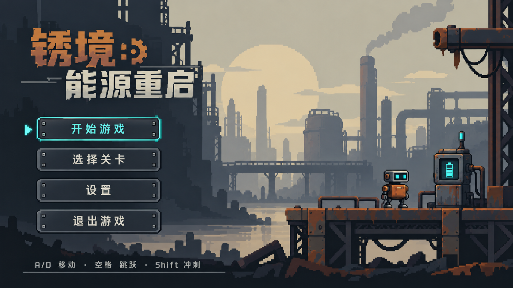

# 锈境：能源重启

[在线试玩](https://bishop-zh.github.io/platform-jumping/) · [WebGL 构建与发布](WEBGL.md)


一款使用 **Unity 2022.3 + C#** 开发的 2D 像素风平台跳跃游戏。玩家操控维修机器人，在废弃工业设施中移动、跳跃和冲刺，利用充电站补充电量，驱动门与升降平台，最终登上能源核心站。




## 游戏流程与操作

主菜单 → 开始游戏 / 选关 → 关卡挑战 → 通关结算 → 下一关。失败后可以选择检查点重试或整关重开，已解锁关卡可重复挑战。

| 操作 | 按键 | 说明 |
| --- | --- | --- |
| 移动 | A / D 或左右方向键 | 水平移动并切换朝向 |
| 跳跃 | Space 或 W | 支持提前输入缓存和离地宽限 |
| 冲刺 | 左 / 右 Shift | 水平冲刺，有冷却，每次离地最多一次 |
| 交互 | E | 使用附近的充电站、拉杆或按钮 |
| 暂停 / 返回 | Esc | 打开设置暂停界面，再次按下继续 |

机器人没有生命值条，接触尖刺或敌人会死亡。护盾可抵挡一次普通伤害，跌出地图仍会死亡。水晶是可选收集，不作为通关门槛；跳跃增强提供临时能力，主线不依赖限时道具。

## 演示重点

### 三关从横向教学过渡到纵向攀登

| 关卡 | 地图结构 | 主要展示内容 | 充电站 / 水晶 |
| --- | --- | --- | --- |
| 01 废料回收区 | 横向，宽 46 单位 | 基础跳跃、推箱压板、开门、检查点与冲刺 | 1 / 13 |
| 02 废弃运输线 | 横向，宽 58.5 单位 | 拉杆与移动平台、巡逻敌人、护盾和供电门 | 2 / 17 |
| 03 能源核心站 | 四层纵向塔，终点高 19.5 单位 | 单向踏板、升降台、垂直相机跟随与顶部供电门 | 1 / 10 |

以上采用最终整合后的关卡规格。早期方案中的三关布局与资源数量保留作设计记录，地图编辑请参照[三关整合与纵向地图](Docs/三关整合与纵向地图.md)。

### 充电与机关形成完整的玩法循环

机器人初始电量为 20，容量为 100。在充电站附近按 E 开始充电，补充电量后再操作供电机关。电量不足时显示提示，机关保持关闭。

`RobotEnergy` 管理电量，`ChargeStation` 负责按时间补充，`WorldSignal` 检查费用并发出信号，由门或平台响应。非压板机关在首次供电时扣费，具体费用配置在关卡对象上。压板免费，由玩家或箱子踩压触发，还可配置持续踩压或锁存模式。

演示时可以依次展示“电量不足 → 充电 → 开门 / 启动平台”，再用推箱压板说明物理交互如何接入同一套机关逻辑。

### 角色动画与游戏状态同步

机器人有待机、跑动、起跳、下落、冲刺、死亡、充电和落地等表现。`PlayerPresentation` 读取运动、落地、死亡与充电状态，向 Animator 写入 `Mode`、`Dead` 参数，并控制冲刺残影。运动由 `PlayerMotor` 和 2D 物理负责，动画负责呈现状态。

### 检查点重试与整关重开有明确边界

`LevelSession.Retry(bool full)` 统一编排复位，世界组件通过 `IWorldReset.ResetWorld(bool full)` 区分两种重试方式。

| 状态 | 检查点重试 | 整关重开 |
| --- | --- | --- |
| 复活位置 | 当前检查点 | 初始出生点 |
| 收集数量、死亡次数与计时 | 保留本次累计值 | 清零 |
| 已收集水晶 | 保持已收集，避免重复计分 | 恢复 |
| 护盾、跳跃增强、冲刺和速度 | 清理 | 清理 |
| 供电状态 | 已支付、锁存的状态保留，普通压板复位 | 全部重置 |
| 机器人电量 | 保留当前电量 | 恢复初始电量 |

这段适合用“触发检查点 → 故意死亡 → 检查点重试 → 整关重开”连续展示，说明局部恢复与完整重置的区别。

## 关键技术与问题解决

### 1. 跟随碰撞箱变化的落地检测

调整角色缩放、碰撞箱大小或 offset 后，固定尺寸的地面探测框容易失效，出现站在地面却无法跳跃、动画保持滞空等问题。

当前 [`PlayerMotor.RefreshGrounded`](Assets/Scripts/World/PlayerMotor.cs) 优先通过 `BoxCollider2D.GetContacts` 读取物理接触，检查接触法线的 Y 分量以识别脚下支撑，排除侧墙、触发器和自身刚体。未找到支撑时，以碰撞箱当前世界 `bounds` 计算脚底 BoxCast，自动跟随尺寸、偏移与缩放变化。选中角色可通过 Gizmo 查看探测范围。


### 2. 输入缓存、离地宽限与移动平台搭载

输入在 `Update` 中采样，物理运动在 `FixedUpdate` 中更新。跳跃请求缓存与离地宽限默认为 0.1 秒，使玩家提前按跳跃或刚走出边缘时仍能得到合理响应。

起跳速度由 `v = √(2gh)` 计算，默认重力 28、跳高 2.2，对应约 11.1 单位 / 秒。水平移动速度 4.5，冲刺速度 10，持续 0.15 秒、冷却 1.2 秒。冲刺只修改水平速度，竖向速度与重力继续生效，空中次数在落地后恢复。这些参数由 [`PlayerTuning`](Assets/Scripts/World/PlayerTuning.cs) 配置资产管理。

[`MovingPlatform`](Assets/Scripts/World/MovingPlatform.cs) 提供位移增量 `Delta`，角色站稳平台时叠加该增量。跳离后停止继承，不需要反复修改角色的父节点。

### 3. 模块化地图与组合碰撞

美术以 32 PPU 为基础，地形模块拼接成平台、台阶和支架。静态平台父级使用 `Rigidbody2D + CompositeCollider2D`，子模块保存 `BoxCollider2D`，组合生成连续碰撞轮廓，减少拼接缝造成的卡顿。

第三关单向踏板增加 `PlatformEffector2D`，承重角度为 160°，允许从下方穿过并站在顶面。移动平台使用 Kinematic 刚体，机关触发器保持独立，避免与实体地形合并。

地图预制体位于 `Assets/Prefabs/Levels/`。编辑入口和组件连接方式见[地图编辑与机关组件说明](Docs/地图编辑与机关组件说明.md)。

### 4. 纵向相机、背景覆盖与多比例适配

第三关启用垂直相机跟随。远景层通过 [`SceneryParallax`](Assets/Scripts/World/SceneryParallax.cs) 配置视差，远景工厂层垂直方向跟随相机；[`CameraBackdropCover`](Assets/Scripts/World/CameraBackdropCover.cs) 按正交相机视口等比铺满背景，处理攀登时顶部露白的问题。

UI 使用 [`FullScreenCanvas`](Assets/Scripts/UI/Common/FullScreenCanvas.cs) 保持控件整体比例，背景单独铺满。全屏优先策略下，部分分辨率的像素放大倍率可能为小数。相关编辑说明见[弹窗按钮与纵向背景修复](Docs/弹窗按钮与纵向背景修复.md)。

### 5. 职责分离、组件事件与共享 HUD

| 模块 | 实际代码入口 | 职责 |
| --- | --- | --- |
| 会话与流程 | `LevelSession` | 暂停、死亡、重试、计时、结算与场景跳转 |
| 玩家运动 | `PlayerMotor`、`PlayerTuning` | 输入、物理、落地、冲刺与参数配置 |
| 玩家表现 | `PlayerPresentation` | 动画参数、充电状态表现与残影 |
| 能量与交互 | `RobotEnergy`、`ChargeStation`、`WorldSignal` | 电量变化、费用判断和机关信号 |
| 世界组件 | `GateController`、`MovingPlatform`、`WorldPickup` | 门、运输、收集和组件复位 |
| 游戏界面 | `WorldHud`、`SpriteNumberLabel` | 会话数据显示和统一像素数字 |
| 进度 | `LevelProgressRepository` | 解锁规则、最佳成绩和持久化 |

组件间通过 `UnityEvent` 等事件连接，例如 `WorldSignal.onChanged` 驱动门与平台、`RobotEnergy.onChargeChanged` 报告电量变化。当前 `LevelSession.Update` 每帧调用 `hud.Refresh(this)` 更新 HUD。集中式状态机和全面事件化刷新仍可作为后续改进，仓库没有把方案中的 `GameFlowController`、`PlayerStateMachine` 当作已实现模块。

唯一的共享游戏界面模板为 `Assets/Prefabs/UI/GameplayHUD.prefab`，运行时绑定当前关卡，修改地图无需复制维护三份 HUD。数字通过 `SpriteNumberLabel` 拼接统一图集，保持计时、电量、关卡编号与结算数字的风格一致。

### 6. 版本化本地存档

[`LevelProgressRepository`](Assets/Scripts/Progress/LevelProgressRepository.cs) 将版本化数据序列化为 JSON，保存到 PlayerPrefs。记录解锁数量、上次进入关卡、最高收集数和最短通关时间，异常或不兼容数据回退到默认进度。

最短时间与最高收集数独立更新，可能来自不同次游玩。检查点是本次运行内的恢复位置，不保存为退出游戏后的续关位置。

## 获取与运行

1. 克隆或下载本仓库，使用 Unity Hub 添加项目根目录。
2. 使用 **Unity 2022.3.62f3c1** 打开，这是工程记录的编辑器版本。首次导入需等待 Package Manager 恢复依赖和 Unity 生成 Library。
3. 打开 `Assets/Scenes/MainMenu.unity`，点击 Play，再从菜单开始游戏。
4. 单独调试关卡时，打开 `Level01.unity`、`Level02.unity` 或 `Level03.unity` 直接 Play。Prefab Mode 用于编辑地图，运行验收请打开对应场景。

工程使用 Built-in 渲染管线与旧版 Input Manager，依赖信息见 `Packages/manifest.json` 和 `Packages/packages-lock.json`。

**正常运行不需要执行 WorldBuilder 或 UI Builder。** 这些维护工具会重建素材或布局；已有场景和预制体可以直接运行。共享 HUD 和运行入口详见[运行入口与共享 HUD](Docs/运行入口与共享HUD.md)。

### 构建 Windows 版本

安装 Unity 的 Windows Build Support 后，在编辑器菜单选择 `Rustbound → Delivery → Build Windows Game`。构建脚本 [`DeliveryBuild`](Assets/Editor/DeliveryBuild.cs) 读取 Build Settings 中的主菜单和三关场景，生成 Windows x64 游戏，默认入口为 `Deliverables/WindowsGame/jump.exe`。

构建目录、Unity 缓存和重复交付压缩包未纳入源码仓库。

## 仓库结构

```text
Assets/
  Scripts/          玩家、世界、UI 与进度逻辑
  Editor/           编辑工具、验证脚本与 Windows 构建入口
  Scenes/           主菜单、三个正式关卡与界面预览场景
  Prefabs/          地图、世界组件与共享 UI
  Art/              游戏使用的美术资源
  Resources/        运行时资源引用
ArtSource/          原始图集、设计预览和素材提示词
Docs/               玩法、地图、UI 与技术说明
  Validation/       已有验证记录的精选副本
Packages/           Unity 包依赖与锁定文件
ProjectSettings/    Unity 项目设置
Tools/              素材处理、打包与辅助脚本
```

## 验证记录与后续改进

仓库保留了[已有验证记录](Docs/Validation/README.md)，覆盖落地检测、地图物理、交互、界面和音频。它们是此前开发阶段的验证输出，本次仓库整理没有重新运行 Unity 测试，也不将分项验证等同于三关完整通关验收。

后续重点是三关连续通关调优、独立 Windows 构建的多比例与长时间性能验证，以及减少交互对象扫描、集中管理会话状态和增加手柄支持。

## 项目资料

- [三关整合与纵向地图](Docs/三关整合与纵向地图.md)
- [修改碰撞箱后的落地检测](Docs/修改碰撞箱后的落地检测.md)
- [机器人动画与充电使用说明](Docs/机器人动画与充电使用说明.md)
- [交互提示与压板箱子](Docs/交互提示与压板箱子.md)
- [游戏 HUD 与暂停界面编辑](Docs/游戏HUD与暂停界面编辑.md)


